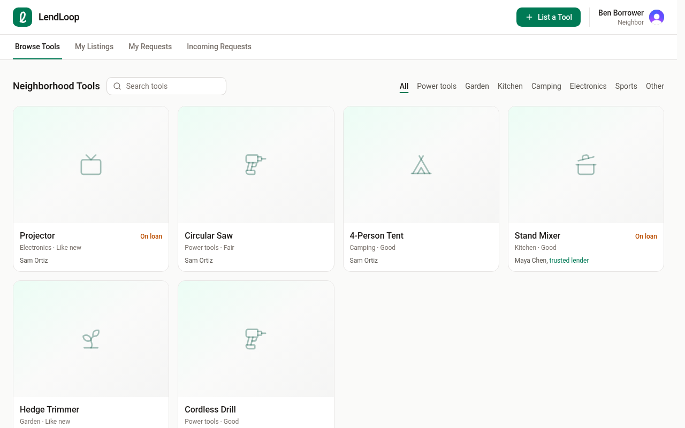
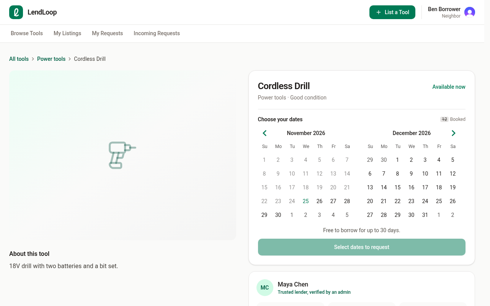
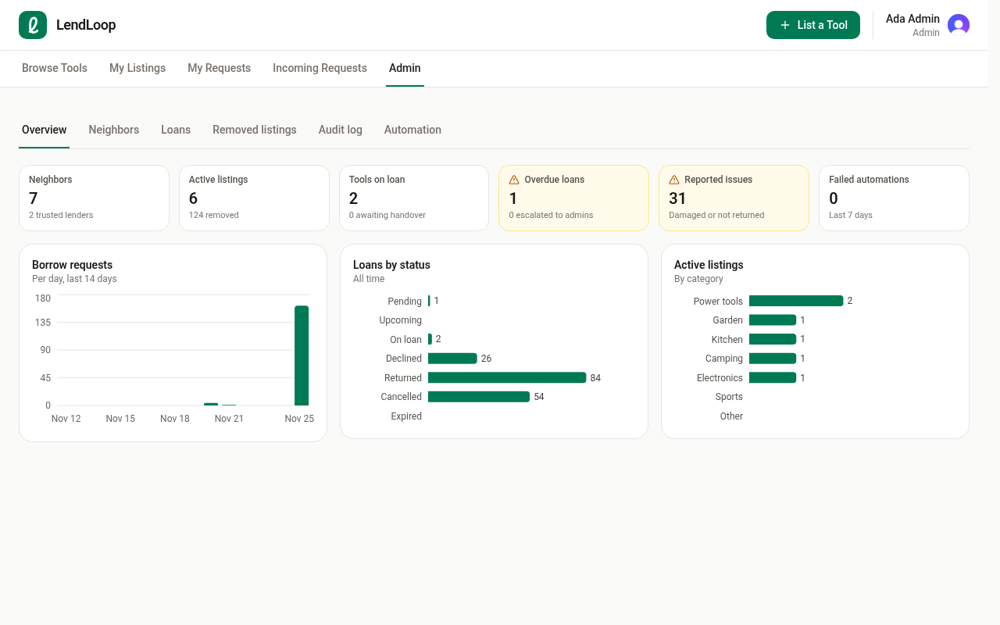
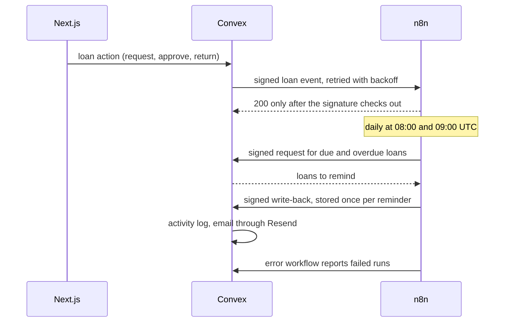

# LendLoop

Neighbors list tools, request them for a date range, and n8n handles notifications and reminders.

Next.js 16 (App Router) · TypeScript 7 · Clerk · Convex · n8n · Tailwind with shadcn/ui

| Browse                              | Tool page                                  | Admin overview                                       |
| ----------------------------------- | ------------------------------------------ | ---------------------------------------------------- |
|  |  |  |

## Features

- **Public board:** - Available tools with name and category only, and a sign-in button.

- **Listings:** - Add name, category, condition, description and upload up to 5 photos. Removed listings can be restored if needed.

- **Tool pages:** - Carousel, trust card, availability calendar, request button.

- **Borrowing:** - Pick dates on a calendar. Owners can see each requester's history before approval. Either side can cancel until the tool is sent.

- **Loan lifecycle:**:
- Either neighbor confirms the handover and the other confirms it or says it didn't happen, which sends the loan back to waiting for pickup and records audit log.
- The borrower marks the tool returned, and the owner confirms the return with a condition report (as expected, damaged or not returned).
- A tool reported as not returned leaves the board and its other bookings are released until the owner restores it.
- Borrowers can request more days, which the owner approves or declines. Stale requests and missed pickups expire nightly.

- **Overdue loans:** n8n reminds the borrower every day. After three days overdue, a Convex cron escalates the loan to the admins.

- **Views:** - Browse with search and category filter, My Listings, My Requests, Incoming Requests (with a pending count).

- **Roles:** `user` manages only their own listings and loans. `admin` gets an overview with charts, all loans, removed listings, the audit log, automation failures, and can remove listings, grant trusted lender status, and suspend or reinstate neighbors.

- Accounts deleted in Clerk are anonymised through a signed webhook. If an owner is suspended or deleted while their tool is out, an admin confirms the return.

- **Email:** every loan event and reminder is emailed to the neighbor it concerns through Resend, with retries and idempotency keys. The address is looked up in Clerk at send time and never stored.

## How n8n fits



## Run locally

1. `npm install`

2. **Clerk:** create an app, then add a JWT template named `convex` with these claims:

- `{"aud": "convex", "name": "{{user.full_name}}", "email": "{{user.primary_email_address}}", "email_verified": "{{user.email_verified}}"}`

- Put `NEXT_PUBLIC_CLERK_PUBLISHABLE_KEY` and `CLERK_SECRET_KEY` in `.env.local`.

3. **Convex:** `npx convex dev` writes its URL to `.env.local`.
4. For a local backend with no account, run `CONVEX_AGENT_MODE=anonymous npx convex dev` instead.
5. Then:
   ```bash
   npx convex env set CLERK_JWT_ISSUER_DOMAIN https://<your-app>.clerk.accounts.dev
   npx convex env set ADMIN_EMAILS you@example.com
   ```
6. **n8n:** copy the n8n values from `.env.example` into `.env.local` and fill in the secrets, then:
   ```bash
   docker compose --env-file .env.local up -d
   docker exec lendloop-n8n n8n import:workflow --separate --input=/opt/lendloop/workflows
   for id in lendloopSignCall lendloopErrHndlr lendloopReqNotif lendloopOverdue1 lendloopDueSoon1; do docker exec lendloop-n8n n8n publish:workflow --id=$id; done
   npx convex env set N8N_REQUEST_WEBHOOK_URL http://localhost:5678/webhook/lendloop-request-event
   npx convex env set N8N_WEBHOOK_SECRET <same as .env.local>
   npx convex env set N8N_CALLBACK_SECRET <same as .env.local>
   ```
7. `npm run seed` adds two demo neighbors and six tools. `npm run dev`, then open http://localhost:3000.

## Try it in three minutes

1. Sign in with the email in `ADMIN_EMAILS`. You get the Admin area.
2. In a private window, sign up as `someone+clerk_test@example.com` (Clerk dev instances accept the code `424242`) and request a tool.
3. With n8n running, every step appears in the loan's activity log, and failures show under Admin, Automation.
4. To see reminders without waiting a day, run `npm run demo:reminders`, then start the Overdue and Due Tomorrow workflows once from the n8n editor.

## Security

| OWASP                  | Measure                                                                                                                                                            |
| ---------------------- | ------------------------------------------------------------------------------------------------------------------------------------------------------------------ |
| Broken access control  | Every public Convex function declares public, user or admin access through one builder, and lint rejects any other way. Each also checks the stored owner or role. |
| Misconfiguration       | Security headers, no `X-Powered-By`, n8n bound to localhost.                                                                                                       |
| Supply chain           | Lockfile with `npm ci`, CI actions pinned to SHAs, Dependabot, gitleaks.                                                                                           |
| Cryptographic failures | HMAC-SHA256 over method, path and body, with a separate secret per direction, constant-time comparison and a 5-minute replay window. Clerk webhooks use `svix`.    |
| Injection              | Typed Convex validators, no string-built queries, React escaping, hidden Unicode rejected in user text.                                                            |
| Insecure design        | Booking rules, the official Convex rate limiter, a listing cap and bounded queries, all enforced on the server.                                                    |
| Authentication         | Clerk. Admin requires a verified email and is re-checked at every sign-in.                                                                                         |
| Integrity              | Payloads are parsed only after the signature checks out. Uploads accept only JPEG, PNG or WebP up to 5 MB.                                                         |
| Logging                | Audit log for privileged actions. Rejected callbacks and rate-limit hits are logged without secrets.                                                               |
| Exceptional conditions | Fail closed when misconfigured, 413 for oversized bodies, webhook retries with backoff, errors surfaced to admins.                                                 |

**Data minimisation:** the public board returns id, name and category only. Webhooks carry a display name, tool name, dates and status, never emails or Clerk IDs. Email addresses are never stored: Convex fetches the address from Clerk when it sends a message and passes it only to Resend.

**Accessibility:** WCAG 2.2 AA: labelled fields, named icon buttons, focus-managed dialogs, keyboard tabs and carousels, a screen-reader table for each chart, and AA contrast.

## Checks

```bash
npm run lint && npm run typecheck && npm test && npm run format:check
npx playwright install chromium
npm run e2e
```

## Why it works this way

- One UTC calendar for everyone, so booking days never shift between time zones. The cost is that a day turns over at midnight UTC.
- Events to n8n are retried with backoff, and both sides drop duplicates by event id, so a retry never notifies twice.
- Listings and accounts are hidden or anonymised, never erased, so loan history and the audit log stay complete.
- Email is best effort: a failed send is retried and logged, but never blocks or undoes the loan change.

## Final Checklist

- A verified sending domain for Resend, plus bounce and complaint handling through Resend webhooks.
- n8n with TLS, a Postgres backend, queue mode, and secrets kept in n8n credentials.
- Sentry, alerts from the error workflow to Slack, and a nonce-based CSP tested against Clerk and Convex.
- Pagination beyond the current 100 to 200 item caps, a cleanup job for orphaned uploads, and per-neighborhood time zones.
- For health data, no personal data in notifications, audit logging of reads, and a BAA with every vendor in the data path.
